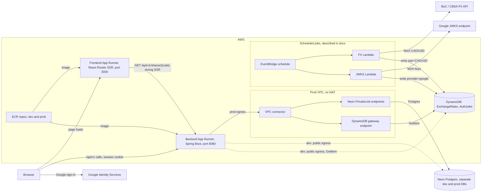
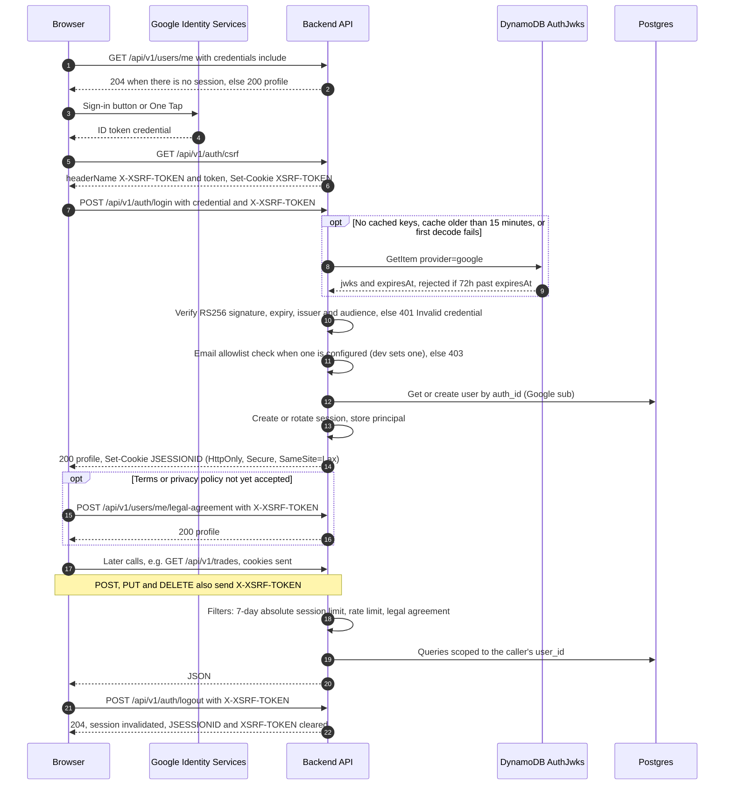
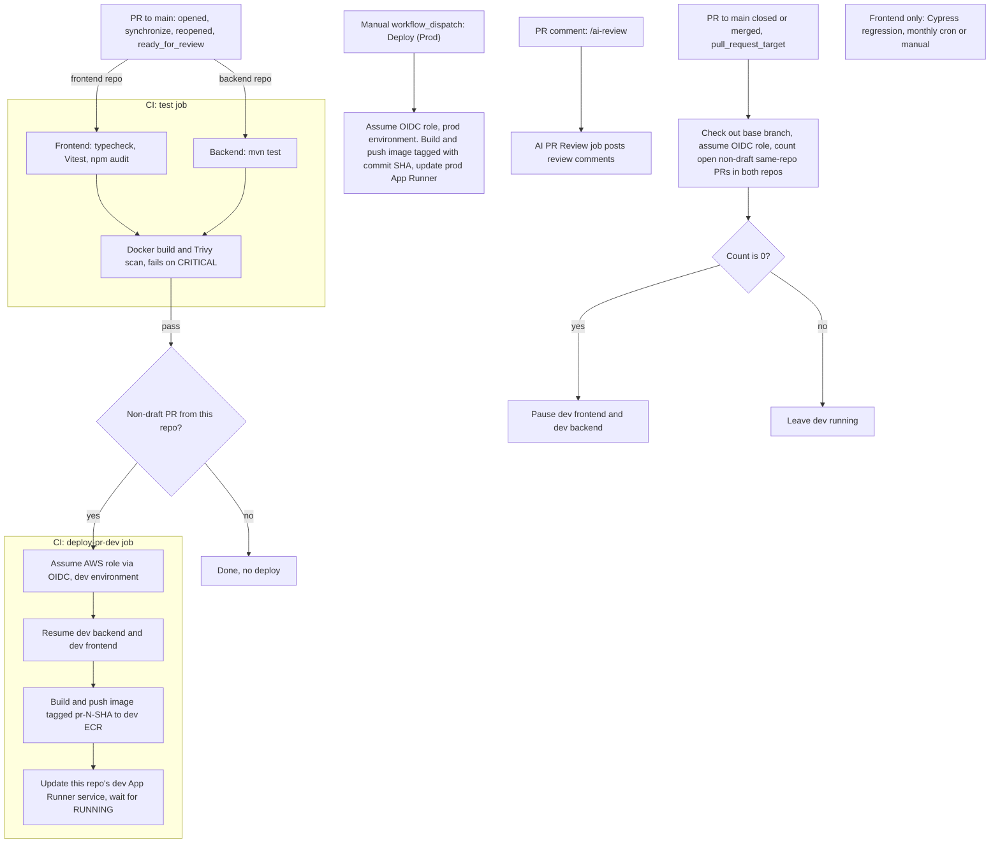
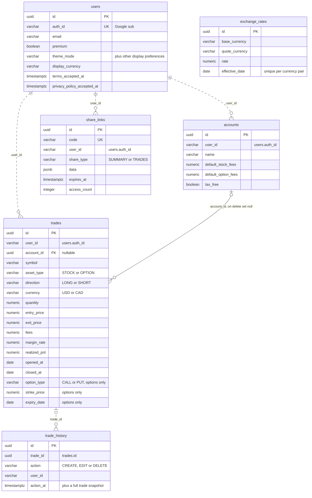
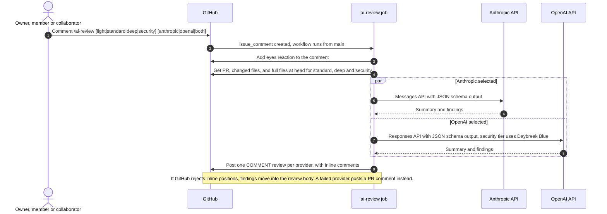

# Architecture

Diagrams for the day-trade journal as it exists on `main`: the `tradingView` frontend (React Router SSR) and the `transaction-api` backend (Spring Boot).

## Runtime and deployment

Both App Runner services have public ingress; only the prod backend uses VPC egress (no NAT) to reach Neon over PrivateLink and DynamoDB over a gateway endpoint, while dev uses public egress. The scheduled Lambdas that fill DynamoDB are not in these repos; they are described in [Private App Runner + Neon Deployment](private-app-runner-neon.md).

## Sign-in and request auth

The browser sends the Google credential to the backend once. After that, the backend's session cookie (`JSESSIONID`, held in the running instance) authenticates requests, and unsafe methods also send the `X-XSRF-TOKEN` header returned by `GET /api/v1/auth/csrf`.

## CI/CD

Both repos run the same lifecycle against one shared dev environment. CI runs only on PRs to `main` (pushes to `main` run nothing), and prod deploys are manual.

## Data model

Tables from the Flyway migrations `V1` to `V17` in `src/main/resources/db/migration`; the only foreign key is `trades.account_id`. Dashed links have no constraint: `user_id` columns hold the user's `auth_id` (Google `sub`), and `trade_history` keeps its rows after a trade is deleted.

## AI PR review

A `/ai-review` comment from the repo owner, a member or a collaborator runs the workflow from `main` with a read-only checkout and `pull-requests: write`. Each selected provider posts its own review as a comment; it never approves or blocks.

